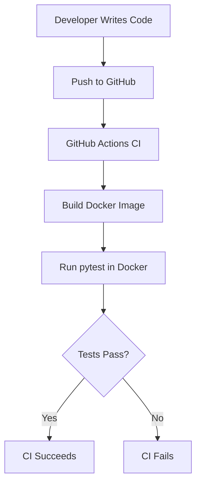

# Calculator App — Architecture

## 1. Overview

This project is a Python calculator package that supports addition, subtraction, and multiplication of positive integers. Input validation ensures that only positive integers are accepted. Unit tests are executed locally and automatically through GitHub Actions using Docker.

## 2. Architecture Diagram

## 3. Component Description

| Component | Responsibility |
|---|---|
| `calculator/operations.py` | Implements calculation functions and input validation. |
| `calculator/__init__.py` | Exposes calculator functions as package imports. |
| `tests/test_operations.py` | Tests valid calculations and invalid inputs using pytest. |
| `Dockerfile` | Defines how to build the image and execute tests in a container. |
| `requirements.txt` | Lists the required Python testing dependency, pytest. |
| GitHub Actions | Automates the Docker build and test execution on every push. |
| Docker | Provides an isolated environment for running the tests. |

## 4. Execution Flow

1. The developer updates the calculator code or tests and pushes the changes to GitHub.
2. GitHub Actions triggers the CI workflow.
3. The workflow checks out the repository and builds the Docker image.
4. Docker creates a container and runs pytest inside it.
5. If all tests pass, the workflow succeeds; otherwise, the workflow fails and reports the error.

## 5. Scope

This diagram represents the implemented CI pipeline.